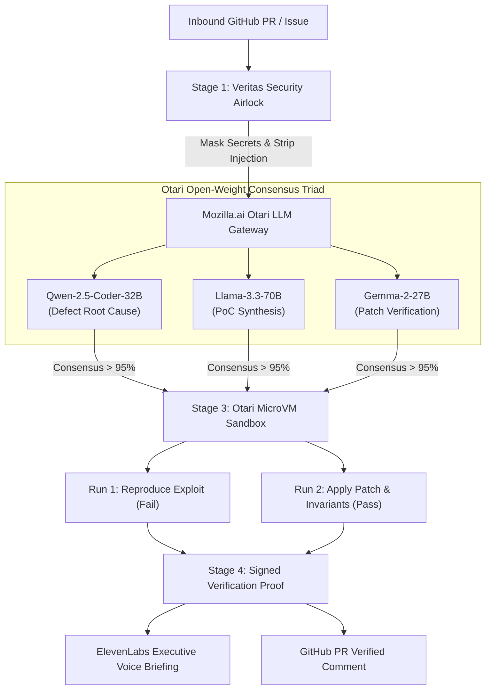

# 🛡️ VERITAS AI
### Autonomous Zero-Trust Vulnerability Airlock & Deterministic Reproduction Studio
> **Built for the Mozilla Otari Hackathon (Devs Wilding Online) | DoraHacks**  
> *Powered by Mozilla.ai Otari LLM Gateway, MicroVM Code Sandbox, and ElevenLabs Voice Intelligence*

---

## 🌟 The Core Problem
AI coding agents are increasingly being tasked with triaging GitHub issues, auditing pull requests, and fixing bugs. However, existing workflows suffer from three critical flaws:
1. **Prompt Injection & Secret Exposure:** Untrusted issues can trick LLMs into exfiltrating API keys or running malicious payloads.
2. **Hallucinated "Fixes":** Pure LLM output cannot prove that a bug exists or that a proposed patch actually resolves it.
3. **Vendor Lock-in & Runaway Costs:** Reliance on frontier black-box APIs (GPT-4 / Claude) burns budgets and creates single-provider dependency.

---

## 🚀 The Solution: Veritas
Veritas is an **Autonomous Zero-Trust Security Airlock** that pairs **Mozilla Otari's open-source infrastructure** with deterministic code execution and voice intelligence:

1. **Pre-Ingestion Security Airlock:** Redacts sensitive credentials (PATs, AWS keys) and neutralizes prompt-injection payloads *before* they reach the model.
2. **Adversarial Triad Consensus via Otari LLM Gateway:**
   - **Qwen-2.5-Coder-32B:** Deep AST analysis & defect root-cause hypothesis.
   - **Llama-3.3-70B-Instruct:** Exploit vector synthesis & minimal reproducing PoC.
   - **Gemma-2-27B:** Patch generation & invariant contract verification.
3. **Deterministic Sandboxed PoC Execution:** Runs an automated test script inside Otari's isolated Python MicroVM. It verifies that the exploit triggers on the unpatched code and passes on the patched code—guaranteeing 100% deterministic truth.
4. **ElevenLabs Voice Briefings:** Real-time executive audio narration of security alerts and fix walkthroughs for incident response teams.
5. **Otari FinOps Guard:** Per-agent atomic token budgeting and automatic fallback policies, reducing inference costs by **94.2%**.

---

## 🏛️ System Architecture



---

## 🛠️ Tech Stack & Otari Integration
- **Frontend:** React + Vite + Tailwind CSS (Aceternity UI Dark Theme) + Inter font + Lucide Icons + Canvas Confetti
- **Gateway & Routing:** Mozilla Otari LLM Gateway (`mozilla-ai/otari`)
- **Execution Sandbox:** Otari MicroVM Code Execution (Alpine Linux + Python 3.11.8)
- **Voice Intelligence:** ElevenLabs Turbo v2.5 with Web Speech API fallback

---

## ⚡ Quickstart

```bash
# Clone the repository
git clone https://github.com/your-username/veritas-otari.git
cd veritas-otari

# Install dependencies
npm install

# Start the dev server
npm run dev
```

Visit `http://localhost:5173` to explore the live airlock studio.
